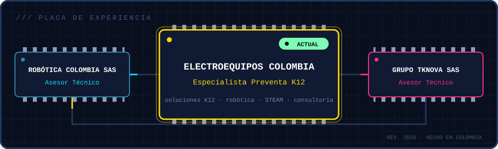

<div align="center">



<br>

<a href="https://linkedin.com/in/andreepinilla"></a>
<a href="mailto:andreenicolasixp@gmail.com"></a>
<a href="https://instagram.com/tricolml"></a>


<br><br>


</div>

## ⚡ `01` &nbsp;Sobre mí



> **No vendo tecnología, diseño experiencias de aprendizaje.** Conecto lo que necesitan los colegios con soluciones de robótica, STEAM y desarrollo que funcionan de verdad en el aula.

<br>

## 🧠 `02` &nbsp;Módulos cargados

<div align="center">

| 🎓 **Preventa & Consultoría** | 🤖 **Robótica Educativa** | 💻 **Desarrollo** | 🎨 **Diseño** |
|:---:|:---:|:---:|:---:|
| Análisis de necesidades K12 | Implementación Arduino | Desarrollo Web Full Stack | UX/UI Design |
| Diseño de soluciones educativas | Programación Raspberry Pi | Python & JavaScript | Adobe Creative Suite |
| Presentaciones técnicas | Proyectos STEAM | Bases de datos | Diseño de interfaces |

</div>

<br>

## 🛠️ `03` &nbsp;Stack tecnológico

<div align="center">

| `[ WEB ]` | `[ SOFTWARE ]` | `[ DATOS ]` | `[ DISEÑO ]` | `[ HARDWARE ]` |
|:---:|:---:|:---:|:---:|:---:|
|  |  |  |  |  |

</div>

<br>

## 🔌 `04` &nbsp;Trayectoria



<details>
<summary><b>📂 Ver detalle de cada nodo</b></summary>
<br>

**🟡 Electroequipos Colombia** · *Especialista Preventa K12* · `ACTUAL`
- 🎯 Diseño e implementación de soluciones tecnológicas educativas para instituciones K12
- 🤝 Consultoría técnica especializada en robótica y STEAM
- 📊 Análisis de necesidades y presentaciones técnicas a instituciones educativas

**🔵 Robótica Colombia SAS** · *Asesor Técnico*
- 🤖 Implementación de soluciones robóticas educativas

**🔴 Grupo Tknova SAS** · *Asesor Técnico*
- 🔧 Soporte técnico y capacitación tecnológica

</details>

<br>

## 🎓 `05` &nbsp;Educación

<div align="center">
  
</div>

<br>

## 🎮 `06` &nbsp;Fuera de horario

<div align="center">

```diff
+ 🤖 Robótica            → construir cosas que se mueven y piensan
+ 📚 Educación en tecnología → que aprender sea práctico y divertido
+ 🎮 Videojuegos          → diseñar mundos, no solo jugarlos
- 😴 Aburrirse           → error 404
```

</div>

<br>

## 🐍 `07` &nbsp;Actividad en tiempo real

<div align="center">
<picture>
  <source media="(prefers-color-scheme: dark)" srcset="https://raw.githubusercontent.com/NicolasPinilla/NicolasPinilla/output/snake-dark.svg">
  <source media="(prefers-color-scheme: light)" srcset="https://raw.githubusercontent.com/NicolasPinilla/NicolasPinilla/output/snake-light.svg">
  
</picture>
</div>

<br>

## 📡 `08` &nbsp;¿Hablamos?

<div align="center">

### 💬 Abierto a proyectos de tecnología educativa, robótica e innovación K12

<table>
  <tr>
    <td align="center" width="25%"><h1>🎓</h1><b>Tecnología Educativa</b><br><sub>Proyectos innovadores para instituciones K12</sub></td>
    <td align="center" width="25%"><h1>🤖</h1><b>Robótica & STEAM</b><br><sub>Implementación de soluciones robóticas</sub></td>
    <td align="center" width="25%"><h1>🚀</h1><b>Innovación K12</b><br><sub>Transformación digital educativa</sub></td>
    <td align="center" width="25%"><h1>💡</h1><b>Consultoría</b><br><sub>Asesoría técnica especializada</sub></td>
  </tr>
</table>

<br>

<a href="mailto:andreenicolasixp@gmail.com"></a>
<a href="https://linkedin.com/in/andreepinilla"></a>
<a href="https://instagram.com/tricolml"></a>

<br><br>


*"En un mundo en constante evolución, la educación y la tecnología se entrelazan como el caos y el orden, guiándonos hacia un futuro donde las posibilidades son infinitas."*


</div>
